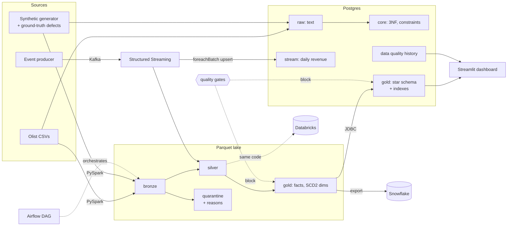

# E-commerce Batch and Streaming ETL Pipeline

Batch and streaming pipelines that ingest e-commerce orders, customers and
payments into a star schema (grain: one row per order line), gated by 115
automated data quality checks, orchestrated by Airflow and run in Docker,
with the same Spark job written for Databricks and the star schema loadable
into Snowflake.

**Stack:** Python, PySpark 4, SQL (Postgres 16), Airflow 3, Kafka 4 with Spark
Structured Streaming, Streamlit, Docker Compose, GitHub Actions, Databricks,
Snowflake.

Two datasets with the same schema:

- **Olist**: the real Brazilian e-commerce dataset from Kaggle (about 100k orders, real data quality problems).
- **Synthetic**: an Olist-shaped generator that scales to millions of rows and records every defect it injects, so the quality checks are measured against ground truth.

## Architecture



## Status

All ten steps are built and pass CI. Each has a study note.

| Step | Topic | Status |
|---|---|---|
| 1 | [Data sources and profiling](docs/steps/STEP-01-data-sources.md) | **done** |
| 2 | [Postgres landing zone and normalization](docs/steps/STEP-02-postgres.md) | **done** |
| 3 | [Batch with PySpark: bronze to silver](docs/steps/STEP-03-spark.md) | **done** |
| 4 | [Dimensional model (star schema, SCD Type 2)](docs/steps/STEP-04-star-schema.md) | **done** |
| 5 | [Data quality framework](docs/steps/STEP-05-data-quality.md) | **done** |
| 6 | [SQL analysis and dashboard](docs/steps/STEP-06-analysis-dashboard.md) | **done** |
| 7 | [Performance tuning (Spark and SQL)](docs/steps/STEP-07-performance.md) | **done** |
| 8 | [Orchestration with Airflow](docs/steps/STEP-08-airflow.md) | **done** |
| 9 | [Streaming with Kafka and Spark Structured Streaming](docs/steps/STEP-09-streaming.md) | **done** |
| 10 | [Databricks, Snowflake, final numbers](docs/steps/STEP-10-cloud.md) | **done** (cloud runs: yours to do, see the note) |

Built step by step, following the order of the
[DataTalksClub Data Engineering Zoomcamp](https://github.com/DataTalksClub/data-engineering-zoomcamp).
See the [roadmap](docs/ROADMAP.md) and [how each step is learned](docs/WORKFLOW.md).
A guided path through the concepts, with exercises and a prerequisite graph
that skips what you already know, is the ETL project section of
[LLM From Zero](https://manojhunasimarad.github.io/llm-from-zero/#/etl).

## Results

Measured by this repository's commands on GitHub Actions runners; every row in
[`docs/RESULTS.md`](docs/RESULTS.md) has its data, command, machine and date.

| | |
|---|---|
| Records ingested into the star schema (full pipeline, 20,000 orders) | 91,521 bronze records |
| Benchmark scale | 915,177 bronze records (201,874 orders) |
| Automated data quality checks | 115 (80 row-level rules, 35 table-level gates) |
| Bad records flagged per run (20,000 orders, 1% defects) | 3,497 quarantined, 622 duplicates removed, 471 fixed; precision and recall 100% |
| Silver + gold runtime, 201,874 orders | 176.9 s → 33.0 s (shuffle partitions sized, broadcast joins) |
| Postgres lookup on the fact | 12.5 ms → 0.013 ms with foreign key indexes |
| Streaming, 3,063 messages with duplicates, late and malformed | revenue in Postgres equals the producer's total exactly |

## Run it

Everything runs in Docker; only Docker is needed.

```bash
docker compose up -d postgres
docker compose --profile pipeline build pipeline
docker compose run --rm pipeline generate --orders 20000
docker compose run --rm pipeline run --source synthetic   # bronze, silver, gates, gold, gates, load
docker compose run --rm pipeline analyze --source synthetic
docker compose --profile dashboard up -d dashboard       # http://localhost:8501
docker compose --profile airflow up -d airflow           # http://localhost:8080
docker compose --profile streaming up -d --wait kafka
docker compose run --rm pipeline produce --source synthetic --limit 5000
docker compose run --rm pipeline stream --source synthetic --reset
docker compose --profile tools up -d pgadmin             # http://localhost:5050
```

Without Docker (Python 3.10+, Java 17 for Spark):

```bash
python -m venv .venv && source .venv/bin/activate        # Windows: .venv\Scripts\Activate.ps1
pip install -e ".[dev,spark,postgres,dashboard,streaming]"
pytest -q                                                # integration tests skip without Postgres/Kafka
python -m ecom_etl --help
```

Real Olist data: `pip install -e ".[kaggle]"`, then
`python -m ecom_etl download-olist` and `--source olist` in any command.

GPU: the Spark batch also runs on an NVIDIA GPU with the RAPIDS Accelerator
(`ECOM_GPU=1`; WSL2 on Windows); see [`docs/GPU.md`](docs/GPU.md) and
`python -m ecom_etl gpu-benchmark`.

Cloud: [`cloud/databricks/`](cloud/databricks/README.md) (notebook for
Databricks Free Edition) and [`cloud/snowflake/`](cloud/snowflake/README.md)
(`export-snowflake`, `load-snowflake`).

## Repository layout

```
src/ecom_etl/
  contracts.py        source data contract: tables, types, keys, rules
  generator.py        synthetic Olist-shaped data + ground-truth defects
  profiling.py        data profiler and markdown report
  olist.py            Kaggle download and header validation
  landing.py, sql/    Postgres raw and 3NF core (step 2), gold constraints and indexes
  spark/              bronze, silver, gold, quality, pipeline, warehouse (JDBC),
                      benchmark, streaming, export, databricks, compat
  events.py           Kafka event producer
  analysis.py         the ten business questions (sql/analysis/)
  snowflake.py        Snowflake DDL, load and checks
  cli.py              python -m ecom_etl <command>
airflow/dags/         the batch DAG
dashboard/            Streamlit app
docker/, docker-compose.yml
cloud/                Databricks notebook, Snowflake notes and queries
tests/                unit tests and integration tests (Spark, Postgres, Kafka)
docs/
  ROADMAP.md          the 10 steps, the job-description mapping, learning material
  WORKFLOW.md         how each step is learned, built and merged
  RESULTS.md          measured numbers only
  STORIES.md          interview stories, one per step
  steps/              one study note per step
```

## Data

Olist data: "Brazilian E-Commerce Public Dataset by Olist", Kaggle,
CC BY-NC-SA 4.0. It is downloaded locally and never committed.
