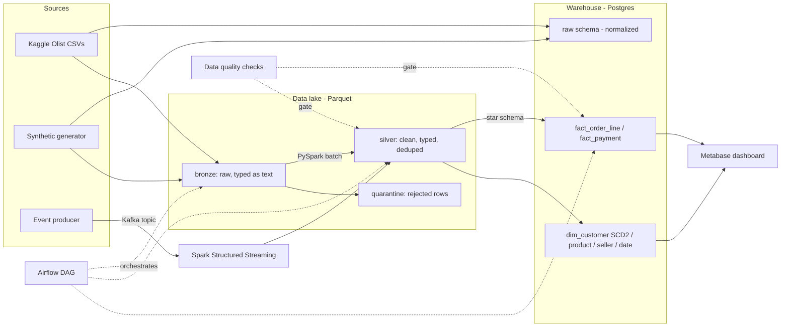

# Roadmap

The project is built in 10 steps. Each step is one branch and one pull
request with a few small commits, has a study note in
[`docs/steps/`](steps/), and must be understood before the next one
starts. How each step is learned and built is described in
[`WORKFLOW.md`](WORKFLOW.md).

Steps follow the order of the
[DataTalksClub Data Engineering Zoomcamp](https://github.com/DataTalksClub/data-engineering-zoomcamp),
applied to an e-commerce domain instead of NYC taxis, and are prioritised
against a campus-hire Data Engineer job description (see the mapping below).

| # | Step | What gets built | Zoomcamp module | Status |
|---|---|---|---|---|
| 1 | Data sources and profiling | Source contract, synthetic Olist-shaped generator with ground-truth defects, Kaggle Olist download, profiler | Prep for 01 | **done** |
| 2 | Postgres landing zone and normalization | `docker-compose` with Postgres + pgAdmin, chunked raw loader, normalized `raw` schema with keys and constraints, 1NF to 3NF | 01-docker-terraform | **done** |
| 3 | Batch with PySpark: bronze to silver | Explicit Spark schemas, typing and cleaning, dedupe, partitioned Parquet lake | 06-batch | next |
| 4 | Dimensional model (gold) | `fact_order_line` (grain: one row per order line), `fact_payment`, `dim_customer` as **SCD Type 2**, `dim_product`, `dim_seller`, `dim_date`; surrogate keys; load to Postgres | 03-data-warehouse, 04-analytics-engineering | |
| 5 | Data quality framework | Checks for nulls, duplicates, referential integrity, freshness, accepted values, ranges; quarantine tables; run report; precision and recall against `_defects.csv` | 04 (tests), 05-data-platforms | |
| 6 | SQL analysis and dashboard | 10 business questions in SQL (CTEs, window functions); Metabase dashboard on the star schema | 03, 04 | |
| 7 | Performance tuning | Spark: partitioning, broadcast joins, AQE, skew, file sizing. SQL: indexes, `EXPLAIN ANALYZE`. Baseline vs tuned timings recorded | 03 (partitioning), 06 (join internals) | |
| 8 | Orchestration with Airflow | Airflow in Docker, DAG for the batch pipeline, retries, backfills, idempotent reruns | 02-workflow-orchestration (Zoomcamp uses Kestra; we use Airflow) | |
| 9 | Streaming | Redpanda/Kafka, order and payment event producer, Spark Structured Streaming with schema, watermark, dedupe and windowed metrics | 07-streaming | |
| 10 | Cloud platforms and wrap-up | Same Spark job on Databricks Free Edition; gold tables in a Snowflake trial; full CI; final numbers | Final project | |

Steps 1 to 7 cover the job description's required skills and duties.
Steps 8 to 10 cover its *preferred* qualifications; if time is short,
they are the ones to shorten. Snowflake goes last on purpose: its trial
lasts 30 days, so start it only when the gold tables are ready.

## Mapping to the job description

| Job description asks for | Where in this project |
|---|---|
| Python and SQL proficiency | every step; SQL focus in 2, 4, 6, 7 |
| ETL concepts, Apache Spark | 1 (ETL vs ELT), 3, 4, 7 |
| Identify internal and external data sources | 1 |
| Design table structures, data models | 2 (normalized), 4 (dimensional) |
| Dimensional modeling **and** normalization principles | 2 (1NF to 3NF), 4 (star schema, grain, SCD2) |
| ETL strategy and automated data quality checks | 3, 5 |
| Pipelines to ingest, transform and deliver data | 2, 3, 4, 8 |
| Dashboards and visualizations | 6 |
| Ad hoc data analysis | 6 |
| SQL and pipeline tuning at scale | 7 |
| Commerce or subscription data domain (preferred) | the whole project (e-commerce) |
| Orchestration tools such as Airflow (preferred) | 8 |
| Streaming data concepts (preferred) | 9 |
| Databricks and Snowflake (preferred) | 10 |
| Data structures and algorithms | outside this project; practise separately |

## Target architecture

## How the numbers get onto the resume

Every `XX` in the resume bullets is produced by a command and recorded in
[`RESULTS.md`](RESULTS.md) with the date and machine. Nothing is typed by hand.

| Resume phrase | Measured in | Source of the number |
|---|---|---|
| ingesting **XX** orders, customers and payments records | Steps 3 and 9 | row counts from the bronze load |
| **XX** automated data quality checks | Step 5 | number of registered checks |
| flagged **XX** bad records per run | Step 5 | quarantine counts per run (real Olist and synthetic) |
| cutting runtime from **XX** to **XX** | Step 7 | benchmark script, baseline vs tuned, same data and machine |

Optional fourth bullet after step 6, for example: "Answered XX business
questions in SQL (CTEs, window functions) and built a Metabase dashboard
on the star schema for revenue and delivery metrics."

## Learning material by step

Each step note lists exact chapters and videos; this is the plan.

| Step | O'Reilly | LinkedIn Learning | Other |
|---|---|---|---|
| 1 | *Fundamentals of Data Engineering* ch. 2, 5 | Data Engineering Foundations; Data Science Foundations: Data Engineering | |
| 2 | *Fundamentals of Data Engineering* ch. 6, 7, and the data modeling part of ch. 8 (normalization) | | **done** |
| 3 | *Learning Spark, 2nd Ed.* ch. 1-4 | Apache Spark Essential Training: Big Data Engineering | next |
| 4 | *The Data Warehouse Toolkit, 3rd Ed.* ch. 1-3, and ch. 5 for slowly changing dimensions | Introduction to Data Warehouses | Zoomcamp modules 03, 04 |
| 5 | *Data Quality Fundamentals* ch. 1-4 | | Zoomcamp module 04 (dbt tests) |
| 6 | *SQL for Data Analysis* (Tanimura) | | Metabase docs |
| 7 | *Learning Spark* ch. 7; *High Performance Spark* | | Zoomcamp module 06 (join internals) |
| 8 | *Data Pipelines Pocket Reference*; Airflow docs | Hands-On Introduction: Data Engineering (Airflow) | Udemy: Marc Lamberti's Airflow course |
| 9 | *Kafka: The Definitive Guide, 2nd Ed.*; *Learning Spark* ch. 8 | Apache Kafka Essential Training: Getting Started | Zoomcamp module 07 |
| 10 | *Snowflake Data Engineering* (Manning, on O'Reilly); *Data Engineering Design Patterns* | | Databricks Free Edition docs, Snowflake trial docs |
