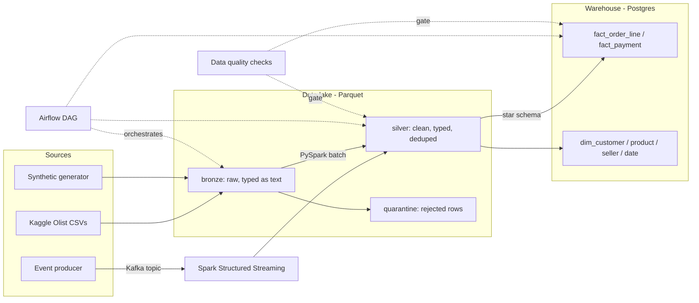

# Roadmap

The project is built in 9 steps. Each step is one commit (or a few), has a
study note in [`docs/steps/`](steps/), and must be understood before the
next one starts. Steps follow the order of the
[DataTalksClub Data Engineering Zoomcamp](https://github.com/DataTalksClub/data-engineering-zoomcamp),
applied to an e-commerce domain instead of NYC taxis.

| # | Step | What gets built | Zoomcamp module | Status |
|---|---|---|---|---|
| 1 | Data sources and profiling | Source contract, synthetic Olist-shaped generator with ground-truth defects, Kaggle Olist download, profiler | Prep for 01 (and FoDE ch. 5) | **done** |
| 2 | Docker and Postgres landing zone | `docker-compose` with Postgres + pgAdmin, chunked raw loader, `raw` schema | 01-docker-terraform | next |
| 3 | Batch with PySpark: bronze to silver | Explicit Spark schemas, typing and cleaning, dedupe, partitioned Parquet lake | 06-batch | |
| 4 | Star schema (gold) | `fact_order_line` (grain: one row per order line), `fact_payment`, `dim_customer`, `dim_product`, `dim_seller`, `dim_date`; surrogate keys; load to Postgres | 03-data-warehouse, 04-analytics-engineering | |
| 5 | Data quality framework | Checks for nulls, duplicates, referential integrity, freshness, accepted values, ranges; quarantine tables; run report; measured against `_defects.csv` | 04 (tests), 05-data-platforms | |
| 6 | Orchestration with Airflow | Airflow in Docker, DAG for the batch pipeline, retries, backfills, idempotent reruns | 02-workflow-orchestration (Zoomcamp uses Kestra; we use Airflow) | |
| 7 | Streaming | Redpanda/Kafka, order and payment event producer, Spark Structured Streaming with schema, watermark, dedupe and windowed metrics | 07-streaming | |
| 8 | Performance tuning | Baseline vs tuned runs: partitioning, broadcast joins, AQE, file sizing, Postgres indexes and `EXPLAIN ANALYZE`; timings recorded | 03 (partitioning), 06 (join internals) | |
| 9 | CI, docs, final numbers | Full CI, architecture diagram, `RESULTS.md` complete, interview prep | Final project | |

## Target architecture

## How the numbers get onto the resume

Every `XX` in the resume bullet is produced by a command and recorded in
[`RESULTS.md`](RESULTS.md) with the date and machine. Nothing is typed by hand.

| Resume phrase | Measured in | Command (when available) |
|---|---|---|
| ingesting **XX** orders, customers and payments records | Steps 3 and 7 | row counts from the bronze load |
| **XX** automated data quality checks | Step 5 | number of registered checks |
| flagged **XX** bad records per run | Step 5 | quarantine counts per run (real Olist and synthetic) |
| cutting runtime from **XX** to **XX** | Step 8 | benchmark script, baseline vs tuned, same data and machine |

## Learning material by step

Each step note lists exact chapters and videos. Planned sources:

| Step | O'Reilly | LinkedIn Learning | Udemy / free |
|---|---|---|---|
| 1 | *Fundamentals of Data Engineering* ch. 2, 5 | Data Engineering Foundations; Data Science Foundations: Data Engineering | Zoomcamp intro |
| 2 | *Fundamentals of Data Engineering* ch. 6, 7 | Docker course of your choice | Zoomcamp module 01 videos |
| 3 | *Learning Spark, 2nd Ed.* ch. 1-4 | Apache Spark Essential Training: Big Data Engineering | Zoomcamp module 06 |
| 4 | *The Data Warehouse Toolkit, 3rd Ed.* ch. 1-3 | Introduction to Data Warehouses | Zoomcamp modules 03, 04 |
| 5 | *Data Quality Fundamentals* ch. 1-4 | | Zoomcamp module 04 (dbt tests) |
| 6 | *Data Pipelines Pocket Reference*; Airflow docs | Hands-On Introduction: Data Engineering (Airflow) | Marc Lamberti's Airflow course |
| 7 | *Kafka: The Definitive Guide, 2nd Ed.*; *Learning Spark* ch. 8 | Apache Kafka Essential Training: Getting Started | Zoomcamp module 07 |
| 8 | *Learning Spark* ch. 7; *High Performance Spark* | | Zoomcamp module 06 (join internals) |
| 9 | *Data Engineering Design Patterns* (2025) | | |
