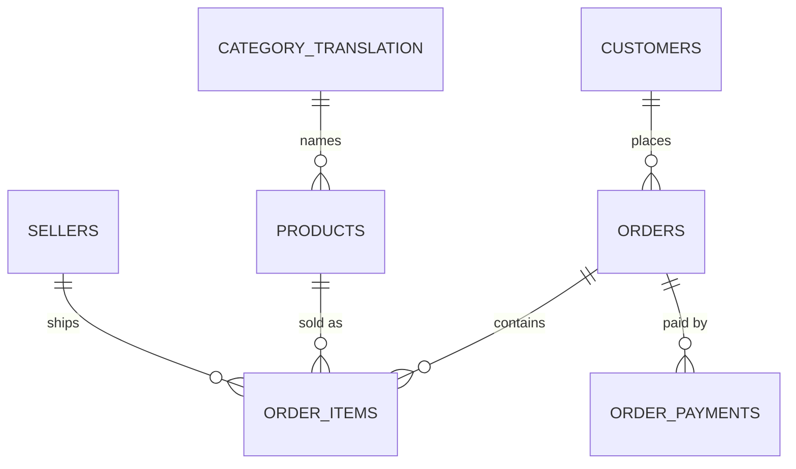

# Step 1: Data sources and profiling

**Goal:** understand the source data completely before writing a single
transformation. By the end of this step you can explain every table, its
grain and keys, and every kind of bad record the pipeline will have to
handle, and you have a tool that finds them.

Nothing here is Spark, Airflow or Kafka yet. That is deliberate: most
pipeline bugs come from misunderstanding the source, not from the tools.

---

## 1. Concepts

### 1.1 Where this step sits in the data engineering lifecycle

*Fundamentals of Data Engineering* (Reis and Housley) splits the work into
five stages: **generation, storage, ingestion, transformation, serving**.
This step is about **generation**: the source systems that produce the
data. Our "source system" is the Olist marketplace database, delivered to
us as CSV exports.

| Lifecycle stage | Where it happens in this project |
|---|---|
| Generation | Olist exports (real) and `generator.py` (synthetic), **step 1** |
| Storage | Postgres (step 2), Parquet data lake (step 3) |
| Ingestion | raw loader (step 2), Spark batch (step 3), Kafka streaming (step 9) |
| Transformation | bronze to silver to gold with PySpark (steps 3-4), quality gates (step 5) |
| Serving | star schema in Postgres (step 4), SQL analysis and dashboard (step 6) |

### 1.2 OLTP source, OLAP target

Olist's tables come from an **OLTP** system (the shop's application
database): normalized, one table per business entity, optimized for
writing one order at a time. Analysts need an **OLAP** shape: few wide
tables, optimized for scanning millions of rows and aggregating. Turning
the first into the second (a star schema) is step 4.

### 1.3 ETL vs ELT, and the medallion layers

* **ETL**: transform before loading into the warehouse.
* **ELT**: load raw data first, transform inside the warehouse (the dbt style).

We land raw data untouched (**bronze**), clean and type it (**silver**),
then model it (**gold**). Keeping bronze untouched means any bug in the
cleaning logic can be fixed and the data re-processed without
re-extracting from the source.

### 1.4 The source tables, their grain and keys

**Grain** is the answer to "one row of this table represents exactly one
what?". Getting it wrong is the classic cause of double-counted revenue.



| Table | One row per... | Primary key | Foreign keys |
|---|---|---|---|
| customers | customer *per order* | `customer_id` | |
| sellers | seller | `seller_id` | |
| category_translation | category | `product_category_name` | |
| products | product | `product_id` | category to category_translation |
| orders | order (header) | `order_id` | `customer_id` to customers |
| order_items | **order line** | (`order_id`, `order_item_id`) | order, product, seller |
| order_payments | payment | (`order_id`, `payment_sequential`) | `order_id` to orders |

Two things that surprise everyone:

1. **`customer_id` is new for every order.** The real person is
   `customer_unique_id`. Counting customers with `customer_id` overcounts
   repeat buyers. (This matters for `dim_customer` in step 4.)
2. **Payments have a different grain from order lines.** An order with 2
   lines paid with a voucher plus a card has 2 item rows and 2 payment
   rows, and they cannot be joined row to row. Joining them naively
   multiplies revenue. That is why the star schema will have two fact
   tables.

### 1.5 Data contract

[`src/ecom_etl/contracts.py`](../../src/ecom_etl/contracts.py) is the
written agreement about what the source looks like: columns, types,
nullability, accepted values, minimums, keys. Every later step reads it:
the profiler now, Spark schemas in step 3, quality checks in step 5. One
source of truth means a rule changes in one place.

It keeps Olist's spelling mistakes (`product_name_lenght`). A contract
describes what you **receive**; renaming is done later, in silver.

### 1.6 Profiling vs data quality checks

* **Profiling** is exploration: what is in here? Counts, nulls, distinct
  values, parse failures, orphans.
* **Data quality checks** are enforcement: rules that run on every
  pipeline run and block or quarantine bad data.

Profiling comes first, and its findings become the checks. Step 5 turns
today's findings into the "XX automated data quality checks" of the resume.

The profiler reads every value **as text**. If pandas guessed types, the
price `"129,90"` would silently become NaN and the zip code `"01037"`
would silently become `1037`; you would never see either problem.

### 1.7 Not every null is a defect

The contract says `product_category_name` may be null (Olist really has
products without a category) and a canceled order has no delivery date.
Those are **legitimate nulls**. A null `customer_id` on an order is a
**defect** because the order cannot be attributed to anyone.

For each kind of defect the pipeline will take one of three actions:

| Action | Meaning | Example |
|---|---|---|
| **fix** | deterministic repair, the value is recoverable | `" Delivered"` becomes `delivered`; `"129,90"` becomes `129.90` |
| **dedupe** | keep one copy of an exact duplicate | the same payment row exported twice |
| **quarantine** | move the row to a quarantine table with the reason | payment for an order that does not exist |

### 1.8 Snapshot semantics and extraction time

An extract is a photo taken at a moment (`extracted_at`). An event cannot
have happened after the photo was taken. So a **delivered** timestamp
after `extracted_at` is impossible, while an **estimated** delivery date
after it is normal (it is a plan, not an event). The contract marks real
events with `event_time=True`. This is also the basis of the
**freshness** check in step 5.

### 1.9 Why synthetic data, and why two random generators

The synthetic generator exists for three reasons:

1. **Volume**: real Olist has about 112k order lines; Spark tuning
   (step 7) needs millions to show anything.
2. **Ground truth**: every injected defect is written to `_defects.csv`.
   That lets us measure the quality checks like a classifier: did they
   catch every bad row (recall) and only bad rows (precision)?
3. **Determinism**: same `--seed`, byte-identical files, so tests and
   benchmarks are repeatable.

It uses two random generators: `rng` builds the clean data and `drng`
decides the defects. Because defects never draw from `rng`, the clean
data is identical whatever `--defect-rate` you choose. The test
`test_clean_rows_are_identical_whatever_the_defect_rate` proves it.

The 14 injected defect types (see `DEFECT_SPECS` in `generator.py`):

| Table | Defect | Action |
|---|---|---|
| customers | duplicate_row | dedupe |
| products | category_missing_translation | fix |
| orders | duplicate_row | dedupe |
| orders | null_customer_id | quarantine |
| orders | status_unnormalized | fix |
| orders | invalid_status | quarantine |
| orders | delivered_before_purchase | quarantine |
| orders | future_purchase | quarantine |
| order_items | orphan_product | quarantine |
| order_items | non_positive_price | quarantine |
| order_items | price_comma_decimal | fix |
| order_payments | duplicate_row | dedupe |
| order_payments | invalid_payment_type | quarantine |
| order_payments | orphan_order | quarantine |

---

## 2. Code tour (read in this order)

1. [`contracts.py`](../../src/ecom_etl/contracts.py): the seven tables. Read it next to the ER diagram above.
2. [`generator.py`](../../src/ecom_etl/generator.py): read the module docstring, then `generate()` top to bottom. Find where each defect is injected.
3. [`profiling.py`](../../src/ecom_etl/profiling.py): `profile_source()` and the check functions. `DEFECT_TO_CHECK` maps each injected defect to the check that should catch it.
4. [`olist.py`](../../src/ecom_etl/olist.py): Kaggle download and header validation.
5. [`cli.py`](../../src/ecom_etl/cli.py): the commands.
6. [`tests/`](../../tests): each test name is a sentence describing a guarantee.

---

## 3. Run it

### Windows (PowerShell), from `D:\sem3_4\ETL`

```powershell
python -m venv .venv
.venv\Scripts\Activate.ps1          # if blocked: Set-ExecutionPolicy -Scope CurrentUser RemoteSigned
pip install -e ".[dev]"
pytest -q                           # 17 tests should pass

python -m ecom_etl generate         # 10,000 orders into data\raw\synthetic
python -m ecom_etl profile          # report in reports\profile_synthetic.md
```

On WSL or Linux use `source .venv/bin/activate`; everything else is the same.

### Real Olist data

```powershell
pip install -e ".[kaggle]"
# kaggle.json from https://www.kaggle.com/settings (API > Create New Token)
# goes in C:\Users\<you>\.kaggle\kaggle.json
python -m ecom_etl download-olist
python -m ecom_etl profile --source olist
```

No Kaggle token? Download the zip from
https://www.kaggle.com/datasets/olistbr/brazilian-ecommerce and run
`python -m ecom_etl download-olist --zip C:\path\to\archive.zip`.

The data is licensed CC BY-NC-SA 4.0 and is git-ignored: the repo holds
code, never data.

A sample report from the default synthetic run is in
[`docs/samples/profile_synthetic_10k.md`](../samples/profile_synthetic_10k.md).

---

## 4. Exercises (do these before step 2)

1. Open `reports/profile_synthetic.md`. For each finding, find the line
   in `generator.py` that caused it.
2. Why does `delivered_before_purchase` show up under **two** sequence
   checks, but count once in "Injected vs detected"?
3. Run `python -m ecom_etl generate --defect-rate 0` and profile again.
   Which finding is left, and why is it `info` and not `error`?
4. Profile the real Olist data. For each finding, decide: **fix**,
   **dedupe**, **quarantine**, or **accept** (legitimate). Write one line
   of reasoning for each.
5. Time a bigger run: `python -m ecom_etl generate --orders 1000000`.
   Note the time and the folder size. We will need both in step 7.

## 5. Check yourself (interview-style)

1. What is the grain of `order_items`? Why can't payments be stored as columns on it?
2. What goes wrong if you count customers with `customer_id`?
3. Why read every column as a string when profiling?
4. Difference between `duplicate_rows` and `duplicate_key`? Which is worse?
5. Why is a null `product_category_name` acceptable but a null `customer_id` not?
6. An estimated delivery date can be in the future; a delivered date cannot. Why does this matter for a pipeline?
7. Why does the generator use two random generators?
8. What is the difference between profiling and data quality checks?

---

## 6. Learning material for this step

**O'Reilly**
- *Fundamentals of Data Engineering* (Joe Reis, Matt Housley, 2022):
  ch. 2 "The Data Engineering Lifecycle" and ch. 5 "Data Generation in
  Source Systems" (files, APIs, OLTP vs OLAP). This is the core reading.
- *Understanding ETL* (O'Reilly report): ch. 1 "Data Ingestion". Short;
  Databricks distributes it free as a PDF.
- Optional preview for step 4: *The Data Warehouse Toolkit, 3rd Ed.*
  (Kimball and Ross) ch. 1.

**LinkedIn Learning**
- *Data Engineering Foundations* (Harshit Tyagi, about 1 hour): the big picture.
- *Data Science Foundations: Data Engineering* (Ben Sullins): staging,
  profiling and cleansing, which matches this step closely.

**Udemy**
- Not needed for this step. Udemy is most useful for hands-on Spark,
  Airflow and Kafka, from step 3 on.

**Zoomcamp (prep for step 2)**
- Watch the Docker and Postgres videos of
  [module 01-docker-terraform](https://github.com/DataTalksClub/data-engineering-zoomcamp/tree/main/01-docker-terraform).
  Step 2 builds the same thing for our data.

---

## 7. Done when

- [ ] `pytest` passes on your machine
- [ ] you have profiled both synthetic and real Olist data
- [ ] you can answer the 8 questions above without looking
- [ ] you have a fix/dedupe/quarantine/accept decision for each Olist finding

Then send the Olist findings and your decisions, and we start step 2.
