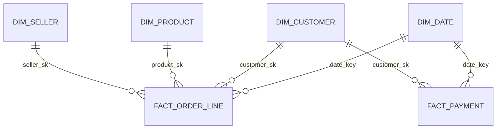

# Step 4: Dimensional model (gold star schema)

**Goal:** reshape clean silver tables into a star schema that answers
business questions with simple, fast joins, and load it into Postgres.

**JD lines this answers:** dimensional modeling; design table structures;
deliver data for analytics and reporting.

---

## 1. Concepts

### 1.1 Facts and dimensions

* A **fact** table records business events with numbers you add up
  (price, freight, payment value). It is long and narrow.
* A **dimension** table describes the *who, what, where, when* of those
  events (customer, product, seller, date). It is short and wide.
* A **star schema** = one fact in the middle, dimensions around it, one
  join hop away. Analysts write `fact JOIN dim ... GROUP BY dim.attribute`.



### 1.2 Grain: decide it first

Kimball's four steps: pick the business process (sales), **declare the
grain**, choose dimensions, identify facts. Our grain is **one row per
order line**. Everything follows from it: `price` and `freight_value`
are additive at that grain; `payment_value` is not (an order paid in
two parts has two payments but maybe one line), so payments get their
own fact table with their own grain. Joining the two facts directly
would multiply revenue: the classic fan-out bug.

### 1.3 Keys

| Kind | Example | Used for |
|---|---|---|
| natural (business) key | `product_id` | identifying the thing in the source |
| surrogate key | `product_sk` | joining facts to dimensions |
| degenerate dimension | `order_id`, `order_status` in the fact | attributes with no table of their own |

Surrogate keys here are `xxhash64(natural key)`: deterministic, so a
re-run produces identical keys (idempotent), and no database sequence is
needed. Trade-off: a 64-bit hash can collide in theory; at millions of
rows the probability is negligible, at billions you would check.

Every dimension has an **unknown member** (`-1`). A fact whose dimension
row is missing points to `-1` instead of vanishing from inner joins;
step 5 verifies that no fact actually uses it.

### 1.4 Slowly changing dimensions (SCD)

What happens when a customer moves city?

| Type | Behaviour | Effect on old orders |
|---|---|---|
| 0 | never change | keep the first city forever |
| 1 | overwrite | old orders now show the *new* city (history rewritten) |
| **2** | **new row per version** with `effective_from`, `effective_to`, `is_current` | old orders keep the city valid *at the time* |
| 3 | extra "previous" column | only one step of history |

`dim_customer` is **Type 2** on (zip, city, state), keyed by the person
(`customer_unique_id`). It is built from order history: consecutive
orders with the same location form one version (`lag` to detect a
change, running `sum` to number versions, `lead` for `effective_to`).

The fact gets its `customer_sk` from a **point-in-time join**:
`effective_from <= purchased_at < effective_to`. Ask "revenue by
customer state last year" and each order counts in the state where the
customer lived when ordering.

### 1.5 Conformed dimensions and marts

`dim_date` is shared by both facts: a **conformed dimension**, so
"payments by month" and "sales by month" use the same calendar.
`agg_daily_sales` is a small pre-aggregated **mart** for dashboards:
the dashboard reads a few hundred rows instead of scanning the fact.

### 1.6 Normalized (step 2) vs dimensional (step 4)

| | 3NF (`core`) | Star (`gold`) |
|---|---|---|
| Optimized for | writes, no anomalies | reads, simple queries |
| Joins for "revenue by category and state" | 5 tables | fact + 2 dimensions |
| Redundancy | none | intentional (category name repeated per product) |

Other modeling styles to know by name: **Inmon** (normalized enterprise
warehouse, marts on top), **Data Vault** (hubs, links, satellites; built
for auditability), and **One Big Table** (fully denormalized, popular with
columnar warehouses). `v_order_lines` in Postgres is a view that gives
analysts the one-big-table experience over the star.

### 1.7 Loading over JDBC

`load-gold` drops and recreates `<source>_gold`, writes each table with
Spark's JDBC writer (batched inserts), then runs
[`gold_constraints.sql`](../../src/ecom_etl/sql/gold_constraints.sql) to
add primary keys, foreign keys and the view. One trap handled in
[`session.py`](../../src/ecom_etl/spark/session.py): JDBC converts
timestamps with the **JVM** time zone, not Spark's session time zone, so
the JVM is pinned to UTC too.

---

## 2. Code tour

1. [`spark/gold.py`](../../src/ecom_etl/spark/gold.py): read the module docstring, then `build_dim_customer` (SCD2) and `build_order_keys` (point-in-time join).
2. [`spark/warehouse.py`](../../src/ecom_etl/spark/warehouse.py) and [`sql/gold_constraints.sql`](../../src/ecom_etl/sql/gold_constraints.sql).
3. [`tests/integration/test_gold.py`](../../tests/integration/test_gold.py): grain, reconciliation, SCD2 contiguity, point-in-time.

## 3. Run it

```bash
docker compose run --rm pipeline gold --source synthetic
docker compose run --rm pipeline load-gold --source synthetic
```

For 5,000 synthetic orders (CI run). Note `dim_customer` has fewer rows
than orders (repeat buyers collapse into one person, movers get extra
versions), and each dimension has one extra row: the unknown member.

```
  dim_date                       651 rows
  dim_customer                 4,660 rows
  dim_product                  1,667 rows
  dim_seller                     157 rows
  fact_order_line              5,333 rows   = silver order_items
  fact_payment                 4,914 rows   = silver order_payments
  agg_daily_sales                606 rows
```

Then in pgAdmin (or any SQL client):

```sql
SELECT category, customer_state, round(sum(line_total), 2) AS revenue
FROM synthetic_gold.v_order_lines
WHERE order_status NOT IN ('canceled', 'unavailable')
GROUP BY 1, 2 ORDER BY revenue DESC LIMIT 10;
```

Right-click the `synthetic_gold` schema → "ERD for schema" to see the star.

## 4. Exercises

1. Find a customer with more than one version in `dim_customer` and list
   their orders with the city from the fact's `customer_sk`. Then do the
   same joining on `customer_unique_id` and `is_current`. What changes?
2. Join `fact_order_line` to `fact_payment` on `order_id` and sum
   `line_total`. Compare with the real total. Explain the difference.
3. Make `dim_customer` Type 1 (one row per person, latest location). What
   test fails, and what business question becomes wrong?
4. Add `dim_order_status` as a junk dimension. Is it worth it here?

## 5. Check yourself

1. What is the grain of each fact table, and why two facts?
2. Surrogate vs natural key: why not join on `product_id`?
3. Explain SCD types 1, 2 and 3 with the customer example.
4. What is a point-in-time join and when do you need one?
5. What is the unknown member for?
6. Why did `agg_daily_sales` exclude canceled and unavailable orders?
7. When would you choose a star schema over one big table, and vice versa?

## 6. Learning material

**O'Reilly**
- *The Data Warehouse Toolkit, 3rd Ed.* (Kimball and Ross): ch. 1-3 (fundamentals, retail sales case study, which is close to this project) and ch. 5 for slowly changing dimension techniques.
- *Fundamentals of Data Engineering*, ch. 8: data modeling approaches (Kimball, Inmon, Data Vault, wide tables).

**LinkedIn Learning**
- *Introduction to Data Warehouses*.

**Zoomcamp**
- [Module 03-data-warehouse](https://github.com/DataTalksClub/data-engineering-zoomcamp/tree/main/03-data-warehouse) and [module 04-analytics-engineering](https://github.com/DataTalksClub/data-engineering-zoomcamp/tree/main/04-analytics-engineering): the same ideas with BigQuery and dbt.

## 7. Done when

- [ ] gold builds and loads for synthetic and Olist
- [ ] you can draw the star schema and state each table's grain from memory
- [ ] you can explain the SCD2 build and the point-in-time join line by line
- [ ] your Step 4 story is in [`STORIES.md`](../STORIES.md)
